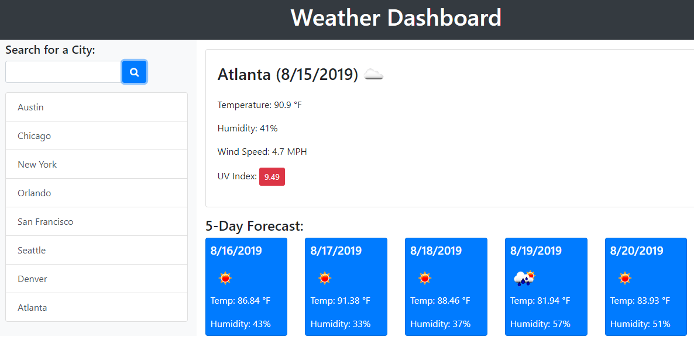

# SkyFlow – A Minimalist Weather Dashboard 🌤️

SkyFlow is a simple and responsive weather dashboard built to make checking weather information quick and easy. It provides real-time weather updates and a 5-day forecast for cities around the world using the OpenWeatherMap API.

The application also remembers recently searched cities, making it easier to check the weather again without entering the same location repeatedly.

## 📸 Preview



## ✨ Features

- **Real-Time Weather:** Displays current temperature, feels-like temperature, humidity, and wind speed.
- **5-Day Forecast:** Shows upcoming weather conditions to help users plan ahead.
- **City Search:** Search for weather information in cities around the world.
- **Search History:** Saves recently searched cities using browser LocalStorage.
- **Responsive Design:** Provides a clean experience across desktop and laptop screens.

## 🛠️ Tech Stack

- **HTML5** – Structures the application.
- **CSS3** – Handles styling, layout, and responsive design.
- **JavaScript (ES6)** – Manages application logic, API requests, and user interactions.
- **OpenWeatherMap API** – Provides current weather and forecast information.
- **LocalStorage** – Stores recently searched cities in the browser.

## 📂 Project Structure

```text
My-weather-application/
│
├── index.html
├── script.js
├── 06-server-side-apis-homework-demo.png
└── README.md
```

## 🚀 Getting Started

Follow these steps to run SkyFlow locally.

### 1. Clone the repository

```bash
git clone https://github.com/anukulchoudhary07/My-weather-application.git
```

### 2. Open the project folder

```bash
cd My-weather-application
```

### 3. Configure the API key

- Visit [OpenWeatherMap](https://openweathermap.org/api).
- Get your API key.
- Add the key in the appropriate location in `script.js`.

### 4. Run the application

Open `index.html` in your web browser.

No additional package installation or build process is required.

## 🌐 API Used

This project uses the [OpenWeatherMap API](https://openweathermap.org/api) to retrieve current weather conditions and forecast data.

**Note:** Configure your own API key before running the application. Avoid committing private API credentials to a public repository.

## 👨‍💻 Author

**Anukul Choudhary**

- GitHub: [@anukulchoudhary07](https://github.com/anukulchoudhary07)
